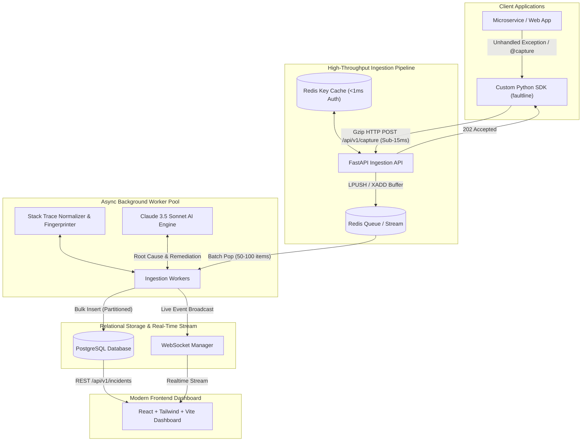

# Faultline – AI Error Monitoring & Observability Platform

<p align="center">
  
  
  
  
  
  
  
</p>

**Faultline** is a high-throughput, centralized observability and error-tracking SaaS (akin to Sentry or Bugsnag). It captures unhandled exceptions, panics, and critical logs from client/server applications via a lightweight custom SDK, aggregates high-volume event streams (**100K+ daily events**) with **sub-15ms ingestion latency**, groups similar traces into intelligent clusters, and leverages **Claude 3.5 Sonnet** to auto-generate root-cause summaries, vulnerable code snippets, and remediation plans.

---

## 🏛 Architecture & Data Flow



---

## ⚡ Key Highlights & Benchmarks

- **Sub-15ms Ingestion Latency**: Async FastAPI endpoint validates incoming payloads and pushes to Redis queue immediately returning HTTP 202.
- **Intelligent Error Clustering**: Deterministic SHA-256 fingerprinting that strips memory addresses (`0x7f8...`), UUIDs, and timestamps to eliminate duplicate incident noise.
- **Claude 3.5 Sonnet Integration**: Auto-generates:
  1. **Root Cause Hypothesis**: Human-readable explanation of why the crash occurred.
  2. **Vulnerable Code Snippet**: Highlights the line of code that failed.
  3. **Step-by-Step Remediation Plan**: Actionable checklist to resolve the failure.
  4. **Suggested Fix Diff**: Unified git-style diff showing the code fix.
- **Custom Python SDK**:
  - Global `sys.excepthook` and `threading.excepthook` captures unhandled crashes.
  - Decorator `@capture_exceptions(tags=...)` and context managers.
  - Ring-buffer breadcrumbs (HTTP, UI clicks, SQL queries).
  - Background daemon thread batching with `atexit` zero-loss flushing.
- **Partitioned PostgreSQL Schema**: Partition-ready event table design with BRIN indexing to handle 100K+ events daily without write locks.
- **Real-Time Live Stream**: WebSockets push live incoming crashes to the frontend dashboard.

---

## 📦 Repository Structure

```
faultline/
├── backend/
│   ├── app/
│   │   ├── api/v1/             # Capture, Incidents, Analytics, WebSockets
│   │   ├── models/             # SQLAlchemy Project, Incident, Event, Metric models
│   │   ├── schemas/            # Pydantic v2 schemas with high-perf validation
│   │   ├── services/           # Cache, Clustering, AI Analyzer, Queue, Storage
│   │   ├── config.py           # Settings and configuration
│   │   ├── database.py         # Dual-driver engine (PostgreSQL + SQLite fallback)
│   │   ├── main.py             # FastAPI entrypoint with CORS & lifecycle
│   │   └── worker.py           # Async batch consumer worker
│   ├── tests/                  # Pytest test suite (Clustering, SDK, API, AI)
│   ├── Dockerfile              # Multi-stage Python 3.11 runner
│   └── requirements.txt
├── sdk/
│   └── python/
│       ├── faultline/          # Custom SDK package (client, decorators, hooks)
│       ├── pyproject.toml
│       └── setup.py
├── frontend/
│   ├── src/
│   │   ├── components/         # Navbar, Sidebar, StackTraceViewer, AiSummaryCard
│   │   ├── pages/              # Dashboard, Incidents, Detail, LiveStream, Analytics
│   │   ├── api/                # REST client & WebSocket manager
│   │   └── App.jsx
│   ├── Dockerfile              # Multi-stage Node 18 -> Nginx Alpine
│   └── vite.config.js
├── examples/
│   ├── simulate_traffic.py     # Burst load generator for demo crashes
│   └── demo_payment_service.py # FastAPI microservice integration
├── deploy/
│   ├── nginx.conf              # Production reverse proxy with SSL & rate-limiting
│   ├── render.yaml             # Render.com IaC blueprint
│   ├── ec2_setup.sh            # Automated AWS EC2 deployment script
│   └── faultline.service       # Systemd unit file
└── docker-compose.yml          # Full-stack Docker orchestration
```

---

## 🚀 Quick Start (Local Development)

### Option A: Running with Docker Compose (Recommended)

```bash
# 1. Clone repository
git clone https://github.com/dhathrivaddiraju/faultline.git
cd faultline

# 2. Launch PostgreSQL, Redis, Backend, Worker, and Frontend
docker compose up -d --build

# 3. Open your browser:
# Frontend Dashboard: http://localhost:3000
# Backend API Docs:   http://localhost:8000/docs
```

---

### Option B: Running Standalone (Zero-Dependency SQLite Mode)

Faultline features automatic SQLite & in-memory queue fallback for instant local running without needing Docker or Redis installed:

```bash
# 1. Install Backend & SDK dependencies
pip install -r backend/requirements.txt
pip install -e sdk/python

# 2. Start the Backend API (runs embedded worker automatically)
uvicorn backend.app.main:app --reload --port 8000

# 3. Start Frontend Dashboard (in a separate terminal)
cd frontend
npm install
npm run dev
# Dashboard available at http://localhost:5173
```

---

## 🧪 Running the Test Suite

```bash
python -m pytest backend/tests -v
```

Output:
```
backend/tests/test_ai_analyzer.py::test_ai_analyzer_hypothesis_and_remediation PASSED
backend/tests/test_clustering.py::test_normalize_path PASSED
backend/tests/test_clustering.py::test_normalize_string_strips_mem_addr_and_uuid PASSED
backend/tests/test_clustering.py::test_fingerprint_deterministic_clustering PASSED
backend/tests/test_clustering.py::test_fingerprint_distinct_for_different_errors PASSED
backend/tests/test_ingest_api.py::test_capture_endpoint_performance_and_auth PASSED
backend/tests/test_sdk.py::test_sdk_init_and_breadcrumbs PASSED
backend/tests/test_sdk.py::test_sdk_decorator_captures_exception PASSED
======================== 8 passed in 13.97s ========================
```

---

## ⚡ Generating Simulated Crashes

To populate your dashboard with realistic crashes across multiple services:

```bash
python examples/simulate_traffic.py
```

---

## 🐍 Python SDK Integration Guide

```python
import faultline

# 1. Initialize SDK
faultline.init(
    api_key="fl_live_production_demo_key_99",
    endpoint="http://localhost:8000",
    environment="production",
    release="v1.0.0"
)

# 2. Record breadcrumbs (HTTP calls, UI clicks, DB actions)
faultline.add_breadcrumb("User clicked 'Checkout'", category="ui")
faultline.add_breadcrumb("Calling payment gateway", category="http", data={"amount": 99.00})

# 3. Automatic Global Crash Capture:
# Any unhandled exception is caught by sys.excepthook & flushed before exit!

# 4. Decorator Capture:
@faultline.capture_exceptions(tags={"service": "billing"})
def process_payment(token):
    if not token:
        raise ValueError("Invalid charge token")

# 5. Manual Capture:
try:
    execute_transaction()
except Exception as e:
    faultline.capture_exception(e, tags={"importance": "high"})
```

---

## 🌐 Production Deployment

### 1. Render Deployment
Deploy Faultline with one click using the included [`render.yaml`](deploy/render.yaml) blueprint:
1. Push repository to GitHub.
2. Link repo to Render.com -> Blueprints -> Create New Blueprint Instance.

### 2. AWS EC2 Deployment
On an Ubuntu 22.04 / 24.04 instance, run:
```bash
chmod +x deploy/ec2_setup.sh
./deploy/ec2_setup.sh
```

---

## 📄 License
MIT License. Crafted with precision for enterprise-grade error observability.
